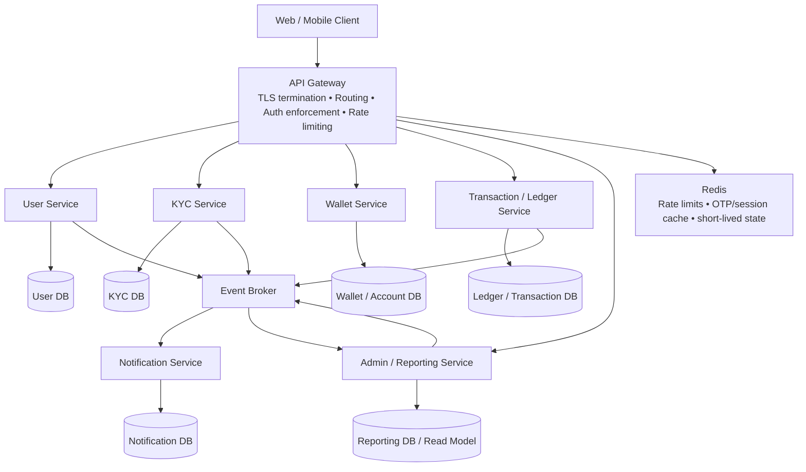
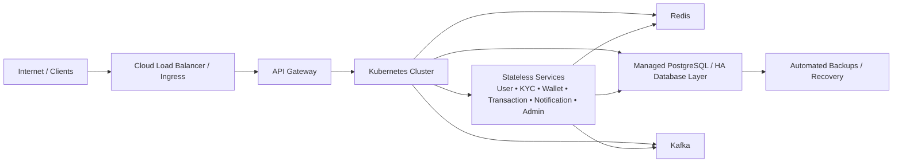

# Requirements

# Document Status

**Project:** WalletPe  

**Document:** Product & System Requirements  

**Version:** 2.0  

**Status:** Requirements Baseline  

**Purpose:** Define the functional, business, security, reliability, and operational requirements for WalletPe before HLD/LLD and implementation.

> **Important:** WalletPe is a learning/project implementation, not a production financial institution. The requirements below use industry-grade engineering principles, but production deployment would require additional regulatory, legal, compliance, licensing, security assessment, and payment-partner requirements.
> 

---

# 1. Product Overview

WalletPe is a digital wallet platform in which eligible users can create a wallet after successful KYC verification and transfer money digitally to other WalletPe users.

The system will initially support internal wallet-to-wallet transfers. External payment rails such as UPI top-up and external withdrawal are planned for Phase 2.

The authoritative financial state must be maintained in a strongly consistent system of record. Notifications, reporting, analytics, and other non-critical side effects may be processed asynchronously.

---

# 2. Product Goals

WalletPe Phase 1 must:

- Provide secure account registration and authentication.
- Verify the user's email address and mobile number.
- Require successful KYC approval before wallet creation.
- Restrict wallet operations to eligible users.
- Support wallet-to-wallet transfers without double-spending or duplicate financial effects.
- Maintain a reliable financial transaction history.
- Provide manual KYC review for Admins.
- Provide operational reporting and notifications.
- Maintain an auditable record of security-sensitive, administrative, and financial actions.
- Support safe retries and recovery from application/network failures.

---

# 3. Actors & Roles

## 3.1 User

A User can:

- Register an account.
- Verify email and mobile number using OTP.
- Authenticate to WalletPe.
- Submit KYC information.
- Track KYC status.
- Create a wallet after KYC approval.
- Receive the initial promotional credit.
- Send money to another WalletPe wallet.
- Receive money from another WalletPe wallet.
- View transaction history.
- Receive applicable notifications.

## 3.2 Admin

An Admin can:

- Review submitted KYC applications.
- Approve or reject KYC applications.
- Put an approved KYC application on hold before wallet creation when an error is identified.
- Select a supported rejection reason.
- View operational reports.
- Trigger an on-demand report refresh.
- Create supported informational or transactional notifications.

All Admin actions that can affect KYC, users, wallets, transactions, notifications, or reports must be auditable.

---

# 4. Phase 1 — MVP

## 4.1 User Eligibility & Account Lifecycle

### Requirements

1. Phase 1 supports users who are **18 years or older**.
2. Age eligibility is determined from verified KYC information.
3. A user may register and authenticate before KYC approval.
4. A user may not create a wallet until KYC is approved.
5. A user may not perform wallet transfers without an eligible wallet.
6. A user account must be uniquely identified by email address and mobile number.
7. The same email address cannot be associated with multiple user accounts.
8. The same mobile number cannot be associated with multiple user accounts.

### User Lifecycle

`REGISTERED → CONTACTS_VERIFIED → KYC_SUBMITTED → KYC_UNDER_REVIEW → KYC_APPROVED / KYC_REJECTED → WALLET_CREATED → ACTIVE`

A rejected user remains registered and may resubmit KYC according to the resubmission policy.

---

# 5. User Registration

## Requirements

The minimum registration information is:

- Name
- Email address
- Mobile number

Both email address and mobile number must be verified using OTP before the account becomes fully verified.

The system must prevent duplicate account creation using an already-registered email address or mobile number.

### OTP Requirements

- OTP must expire after a short configurable period.
- OTP verification attempts must be rate-limited.
- Repeated OTP requests must be throttled.
- OTPs must not be stored or logged in plaintext.

Exact OTP lifetime and attempt limits will be defined during security/LLD design.

---

# 6. Authentication & Authorization

## Requirements

- WalletPe will issue JWT-based access tokens after successful authentication.
- Google OAuth 2.0 will be supported as an authentication option.
- OAuth is an authentication mechanism; WalletPe remains responsible for application authorization and its own user identity mapping.
- Role-based authorization will distinguish User and Admin capabilities.
- Every request accessing a user-owned resource must perform server-side authorization.
- Administrative APIs must enforce Admin authorization independently of client-side UI controls.

## Token Policy

Phase 1 uses:

- Short-lived access token: approximately 10–15 minutes.
- Rotating refresh token: approximately 7 days.
- Refresh token rotation/revocation will be used to reduce replay risk.
- A user may be required to re-authenticate earlier when a security-sensitive event occurs.

---

# 7. KYC Management

## 7.1 Requirements

1. KYC is mandatory before wallet creation.
2. The user submits the required identity information/documentation.
3. Phase 1 uses manual Admin review.
4. The user can view the current KYC status.
5. Only an approved KYC application can unlock wallet creation.
6. Rejection must contain a predefined reason.
7. KYC review actions must be auditable.

## 7.2 KYC Lifecycle

`NOT_STARTED → SUBMITTED → UNDER_REVIEW → APPROVED / REJECTED`

An approved KYC application may be moved to `ON_HOLD` before wallet creation if an administrative error or new verification concern is identified.

## 7.3 Re-Submission Policy

- Document-quality or incorrect-document rejection: user may reapply after 48 hours.
- Age/eligibility-related rejection: user may reapply after 15 days.
- Rejection reasons should come from a controlled list.

Initial rejection reasons include:

- Age not eligible
- Document unclear
- Incorrect document uploaded

## 7.4 KYC Data Protection

The production system must minimize storage of Aadhaar information.

Phase 1 should:

- Avoid using Aadhaar number as an internal/domain identifier.
- Avoid storing Aadhaar numbers or OTPs in application logs.
- Store only the minimum identity data required for the project's verification workflow.
- Store masked/reference information rather than unnecessary full identifiers.
- Store uploaded documents only in protected storage with strict access control and encryption.
- Keep an audit trail for access to sensitive KYC information.
- Define a retention and deletion policy before production use.

For this learning project, **use synthetic/test KYC data rather than real Aadhaar documents**. A real Aadhaar integration would require compliance with UIDAI requirements and applicable Indian law/regulation. UIDAI explicitly states that Aadhaar should not be used as a domain-specific identifier and places security restrictions on identity data handling. citeturn293813search11turn293813search13

---

# 8. Wallet Management

## 8.1 Requirements

1. A wallet can be created only after approved KYC.
2. Phase 1 supports one user → one wallet.
3. Each wallet has a unique, non-sensitive wallet identifier.
4. Wallet identifiers are used to identify recipients for internal transfers.
5. A wallet must have a clearly defined status, such as `ACTIVE` or `BLOCKED`.
6. A blocked/ineligible wallet cannot perform transfers.
7. Wallet balance must never become negative because of a valid transfer.

## 8.2 Financial Record of Truth

Wallet balance is a financial value and must not rely only on an editable counter.

Phase 1 must maintain:

- Wallet balance/state.
- Immutable financial transaction/ledger records.
- A clear relationship between balance changes and ledger entries.

The ledger becomes the authoritative financial history used for reconciliation and investigation.

## 8.3 Initial Promotional Credit

A newly created wallet receives a one-time promotional credit of **₹1,000** from the company.

Requirements:

- The credit is granted exactly once per user.
- Duplicate requests/retries must not create multiple ₹1,000 credits.
- The credit must be represented as a financial transaction/ledger entry.
- The wallet balance must reflect the credit only after the financial operation is successfully committed.
- The intended business SLA is that the credit becomes available within 24 hours of wallet creation.

### Recommended Phase 1 behaviour

Where wallet creation and the promotional credit use the same authoritative database, they should be committed as one atomic business operation whenever practical. This removes the unnecessary "wallet exists but promotional balance disappeared" state.

If a separate asynchronous process is intentionally used, the credit operation must be idempotent and reconciliable.

---

# 9. Money Transfer

## 9.1 Scope

Phase 1 supports internal transfers only:

`Sender Wallet → Recipient Wallet`

No external payment network is involved in Phase 1 transfers.

## 9.2 Transfer Rules

- Minimum transfer amount: ₹0.01.
- Maximum transfer amount: ₹5,000 per transaction.
- Sender and recipient are identified by wallet ID.
- Sender must have sufficient available balance.
- Sender and recipient must be different wallets.
- Both wallets must be eligible to transact.
- Every transfer receives a unique transaction identifier.
- Every client request that can move money must support idempotency.
- A duplicate request must not produce a second financial effect.

## 9.3 Atomic Transfer Requirement

For an internal transfer, the following financial effects must be committed as one atomic operation:

1. Validate the sender and recipient.
2. Validate available balance.
3. Debit the sender.
4. Credit the recipient.
5. Record the financial transaction/ledger entries.
6. Mark the transfer as successful.

If the operation cannot commit completely, the financial state must remain unchanged.

> **Important correction:** Because Phase 1 transfers are between wallets owned by the same system, there is no reason to model a normal transfer as "debit sender, then retry recipient credit for 60 seconds". That pattern becomes relevant when external systems are involved. For a single authoritative database, the correct Phase 1 requirement is atomic commit/rollback.
> 

---

# 10. Concurrency & Double-Spend Prevention

Concurrent transfers against the same wallet must not produce:

- Negative balances.
- Double spending.
- Lost updates.
- Duplicate financial effects.
- Incorrect ledger entries.

The implementation must guarantee a correct outcome under concurrent requests.

The specific mechanism is an architecture/LLD decision and is not mandated here. Candidate mechanisms include database row locking or optimistic concurrency control.

Kafka must **not** be treated as a substitute for the financial consistency boundary merely because it provides ordered message processing.

---

# 11. Transaction Lifecycle & Failure Handling

## 11.1 Phase 1 Transaction States

The recommended business state model is:

`PENDING → SUCCESS`

`PENDING → FAILED`

`PENDING → REVERSED` only for explicitly defined exceptional recovery cases.

For a normal internal transfer, the financial operation should complete atomically within one database transaction, so `PROCESSING` should not become a long-lived user-visible state.

### State Definitions

- **PENDING:** Transfer request has been accepted but the final financial outcome has not yet been recorded.
- **SUCCESS:** Sender debit, recipient credit, and required ledger records committed successfully.
- **FAILED:** Transfer was rejected or safely rolled back without a permanent financial effect.
- **REVERSED:** A previously recorded financial effect was intentionally compensated through a separate reversal transaction.

## 11.2 Retry Safety

A client retry after a timeout must return or resolve to the outcome of the original request rather than create a new transfer.

Idempotency is required for:

- Transfer initiation.
- Promotional credit.
- Future payment-provider callbacks.
- Reversal operations.

## 11.3 Crash / Network Failure

If the application crashes before database commit, the database transaction must roll back.

If the client cannot determine whether the transaction committed, the client must retry using the same idempotency key. The server must resolve the existing transaction rather than create another one.

## 11.4 Reconciliation

A scheduled reconciliation process should identify transactions or ledger records that are inconsistent or remain unexpectedly unresolved.

Reconciliation is a safety mechanism; it must not be used to hide an incorrect primary transaction model.

---

# 12. Receiving Money

A successful incoming transfer must:

- Increase the recipient's available balance correctly.
- Create the appropriate financial transaction/ledger record.
- Appear in transaction history.
- Be included in applicable notification processing.

The recipient does not require a separate "accept money" step in Phase 1.

---

# 13. Transaction History

Users must be able to view their own transaction history.

Each transaction record should expose at least:

- Transaction identifier.
- Direction: sent/received.
- Counterparty identifier/name as permitted.
- Amount.
- Status.
- Timestamp.

Transaction history must support:

- Pagination.
- Date-range filtering.
- Status filtering.
- Appropriate authorization so that a user can access only their own transaction information.

Server-side authorization must be applied to every object lookup. This aligns with OWASP's emphasis on preventing broken object-level authorization in APIs. citeturn293813search0

---

# 14. Notifications

## 14.1 Phase 1 Scope

Phase 1 focuses on transactional and informational notifications.

Supported use cases include:

- KYC reminder.
- KYC submitted/approved/rejected notification.
- Transfer success/failure notification.
- Wallet-related informational notification.
- Admin-created informational communication.

Promotional campaign management is deferred to Phase 2.

## 14.2 Delivery Model

Notification delivery may be asynchronous because notification failure should not roll back a successful financial transaction.

### TBD for implementation

- Initial channel: in-app notification recommended for Phase 1.
- Email/SMS/push can be added later.
- Delivery retry policy.
- User notification preferences.

---

# 15. Admin Reporting

Phase 1 reporting must include at least:

- Successful transactions.
- Failed transactions.
- Pending transactions.
- Total transaction count.
- Total transferred amount.

Reports are generated daily by scheduled background processing.

The Admin must have a manual refresh option for current operational data.

Reports are **derived views** and are not the authoritative source for wallet balances.

---

# 16. Auditability

The system must maintain an audit trail for security-sensitive, administrative, KYC, wallet, and financial operations.

Audit events should include at least:

- User registration.
- Authentication/security events.
- KYC submission and review.
- Wallet creation/blocking.
- Financial transactions and reversals.
- Admin actions.
- Notification creation.
- Report generation or administrative report actions.

An audit record must contain, where applicable:

- Timestamp.
- Actor/user ID.
- Action.
- Target/resource ID.
- Result/status.
- Correlation/request ID.
- Source/context information appropriate to the operation.

IP address may be included where legally and operationally appropriate.

> **Change from the original requirement:** "Audit every read and write" is too broad. Logging every read can generate enormous volume and unnecessary exposure of sensitive data. Phase 1 should audit security-sensitive and privileged access, while ordinary high-volume reads can be handled through application/access logs and monitoring.
> 

### Retention

Phase 1 target: retain audit records for **at least 1 year** for the project, with retention configurable so that a real deployment can align it with applicable legal/regulatory requirements.

---

# 17. Consistency & Availability

## 17.1 Strong Consistency Required

Strong consistency is mandatory for:

- Wallet balance changes.
- Sender debits.
- Recipient credits.
- Financial ledger entries.
- Transfer completion state.
- Idempotency state for money-moving requests.
- Reversal state.

## 17.2 Eventual Consistency Permitted

Eventual consistency is acceptable for:

- Notifications.
- Analytics.
- Daily report aggregates.
- Non-authoritative dashboard summaries.
- Search/read-optimized projections.

## 17.3 Availability Policy

When the system cannot safely determine or guarantee a financial outcome, it must fail closed for the financial operation rather than guess.

Example:

`Unable to safely process transfer → reject/defer request → preserve funds → allow retry`

Financial correctness takes priority over accepting a transaction that cannot be safely committed.

---

# 18. Performance & Scalability

## 18.1 Capacity Target

The previous requirement of "1 million users per minute" has been replaced with a request-based requirement because users/minute is not a useful API capacity metric.

Phase 1 target:

- **Sustained:** 5,000 requests/second across transaction-related APIs.
- **Peak:** 10,000 requests/second for short bursts.
- Transaction throughput target will be measured separately from general API traffic.

These are engineering targets for the project, not claims about production banking capacity.

## 18.2 Latency Targets

Initial API targets:

- Balance lookup: P95 ≤ 200 ms.
- Transfer initiation: P95 ≤ 500 ms under normal operating conditions.
- Non-critical asynchronous work is excluded from the synchronous API latency budget.

## 18.3 Reliability Target

For financial APIs:

- Requests must not create incorrect financial state even during partial failures.
- Error rates and saturation must be observable.
- Capacity should degrade predictably rather than corrupting state.

> The project should later validate these targets using load tests instead of treating them as guaranteed performance.
> 

---

# 19. Security Requirements

Security is a first-class requirement because WalletPe handles financial and identity-related data.

Phase 1 must include:

- Strong authentication.
- Server-side authorization.
- Role-based access control.
- Input validation.
- Secure secret management.
- TLS for network communication.
- Password/credential protection where passwords are used.
- OTP rate limiting.
- Transfer rate limiting and abuse controls.
- Idempotency for money-moving requests.
- KYC data minimization.
- Encryption/protection for sensitive stored data.
- Security-sensitive audit logging.
- Protection against broken object/function-level authorization.
- Protection against unrestricted resource consumption.

OWASP identifies broken object-level authorization, broken authentication, broken function-level authorization, unrestricted resource consumption, and unrestricted access to sensitive business flows among major API risks. citeturn293813search0turn293813search7

### Advanced Controls

The following are valuable but not required for the first implementation:

- MFA.
- Device fingerprinting.
- Fraud scoring.
- Behavioural risk analysis.
- Advanced session/device controls.

---

# 20. Event-Driven Processing

Kafka is planned for asynchronous processing where it provides a clear engineering benefit.

Possible Phase 1 event consumers:

- Notifications.
- Reporting/analytics.
- Reconciliation triggers.
- Other non-critical downstream workflows.

### Financial Boundary

The authoritative internal transfer must not depend on asynchronous Kafka delivery to establish the final wallet balance.

A successful financial transaction must already be committed in the authoritative store before downstream consumers process the corresponding event.

Consumers must be idempotent because duplicate event delivery must not produce duplicate business effects.

### Open Design Decisions

To be finalized during HLD/LLD:

- Event catalogue.
- Topic/partition strategy.
- Ordering requirements.
- Retry policy.
- Dead-letter strategy.
- Consumer idempotency strategy.

---

# 21. Scheduled Jobs

Phase 1 will use scheduled jobs for:

- Daily report generation.
- Reconciliation checks.
- Other periodic operational work identified during implementation.

Jobs must be retry-safe and idempotent.

A scheduled job must not create duplicate financial effects when executed more than once.

---

# 22. Deployment & Engineering

## Phase 1

- Docker for containerization.
- Kubernetes for orchestration.
- Jenkins for continuous integration.
- Local and cloud deployment support.

## CI Expectations

The CI pipeline should validate at least:

- Build.
- Unit tests.
- Integration tests where applicable.
- Static/lint checks.
- Container build validation.
- Artifact creation.

Deployment strategy is intentionally separate from CI and can be expanded in Phase 2.

### Initial Environment

Cloud provider: **TBD**.

Kubernetes environment: local development plus a cloud-compatible deployment target.

Observability stack: **TBD**, but production-like operation should include metrics, logs, traces where appropriate, health checks, and alerting.

---

# 23. Phase 2 — Planned Extensions

Phase 2 will extend the stable Phase 1 financial core.

## 23.1 UPI / External Top-Up

Users may add money through UPI or another external payment rail.

Requirements will include:

- Payment initiation.
- Provider integration.
- Callback/webhook handling.
- Idempotent callback processing.
- Payment status tracking.
- Reconciliation with the payment provider.
- Wallet credit only after authoritative payment confirmation.
- Failure and reversal handling.

## 23.2 External Withdrawal

Potential support for withdrawing funds to external bank/UPI destinations.

Requirements will include:

- Withdrawal initiation.
- Destination validation.
- External-provider processing.
- Idempotency.
- Status tracking.
- Failure/reversal handling.
- Reconciliation.

## 23.3 Multi-Wallet Support

The one-user/one-wallet restriction may be expanded to multiple wallets per user.

This will require new ownership, selection, authorization, and transfer rules.

## 23.4 Automated KYC

Manual KYC may be supplemented by a compliant identity-verification provider.

Automated verification must support manual-review fallback for exceptions.

## 23.5 Notification Expansion

Potential additions:

- Push notifications.
- Email.
- SMS.
- User preferences.
- Promotional campaigns.
- Segmentation.
- Delivery analytics.

## 23.6 Advanced Reporting & Analytics

Potential additions:

- Near-real-time dashboards.
- User activity analytics.
- Transaction trends.
- Failure analysis.
- Reconciliation dashboards.
- Operational SLO dashboards.

## 23.7 Advanced Security & Risk

Potential additions:

- MFA.
- Device intelligence.
- Fraud/risk scoring.
- Velocity controls.
- Suspicious activity detection.
- Advanced session management.

---

# 24. Phase 1 Acceptance Criteria

Phase 1 is functionally acceptable when the following can be demonstrated:

1. A user cannot create a wallet without approved KYC.
2. Only eligible wallets can send or receive funds.
3. A transfer cannot cause an invalid negative balance.
4. Concurrent transfers cannot corrupt wallet balances.
5. Retrying the same transfer cannot duplicate its financial effect.
6. Successful transfers atomically update sender, recipient, and financial records.
7. Failed transfers do not leave unexplained financial debits.
8. Transaction history accurately reflects financial operations.
9. Admins can review KYC and access required reports.
10. Security-sensitive and financial operations are auditable.
11. Scheduled jobs and asynchronous consumers are safe to retry.
12. The system can recover safely from process crashes and network timeouts without duplicating money movement.

---

# 25. Requirements That Are Explicitly Design Decisions Later

The following should **not** be prematurely fixed in the requirements document:

- Exact microservice boundaries.
- Database locking mechanism.
- SQL schema.
- Kafka partition count.
- Exact Kafka topic names.
- API endpoint naming.
- Cloud provider services.
- Kubernetes deployment topology.
- Caching technology.
- Database scaling strategy.

These belong to HLD/LLD after the requirements baseline is stable.

---

# 26. Requirements Baseline

**Phase 1:** The requirements in this document are the implementation baseline for the first version of WalletPe.

**Phase 2:** Features listed under Phase 2 are intentionally excluded from the Phase 1 implementation unless explicitly promoted later.

**Next milestone:** Create the HLD from this requirements baseline. The HLD should explain how the system satisfies these requirements without changing the business requirements silently.

# High-Level Design (HLD)

**Project:** WalletPe  

**Status:** Design Baseline  

**Scope:** Phase 1 MVP with Phase 2 extension points  

**Architecture principle:** Financial correctness first; asynchronous processing only for non-critical side effects.

## 1. HLD Objectives

The HLD defines the major system components, service boundaries, data ownership, communication patterns, financial consistency model, reliability mechanisms, security boundaries, and deployment topology for WalletPe.

The design intentionally avoids premature implementation details. Database schemas, API contracts, class structures, exact SQL, and code belong to LLD and implementation.

## 2. Architecture Principles

1. **Financial state is authoritative and strongly consistent.**
2. **The ledger is the source of truth for financial movements; wallet balance is maintained as an account state that must reconcile with ledger entries.**
3. **A single service owns a business capability and its data.**
4. **No service directly modifies another service's database.**
5. **API Gateway is an entry point, not a business orchestrator.**
6. **Kafka is used for asynchronous side effects, not as the mechanism that makes an internal money transfer correct.**
7. **All financial commands are idempotent.**
8. **Failure must produce a recoverable, auditable financial state.**
9. **Read/reporting workloads must not compromise the financial write path.**
10. **Infrastructure technology does not dictate domain boundaries.**

## 3. Logical Architecture



> **Architecture note:** The diagram shows logical ownership. Physical deployment may place multiple logical services on the same Kubernetes cluster or node pool. Database isolation is a service-ownership boundary; it does not require a separate database server for every service in the first deployment.
> 

## 4. Component Responsibilities

### 4.1 API Gateway

Responsible for:

- Single public entry point.
- TLS termination where applicable.
- Request routing to the appropriate service.
- Authentication/token enforcement at the edge where appropriate.
- Rate limiting and abuse protection.
- Request correlation ID propagation.
- Basic request validation and payload-size limits.
- Hiding internal service topology from clients.

The gateway must not:

- Own wallet balances.
- Execute financial business rules.
- Coordinate a multi-step money transfer.
- Become the source of truth for authorization decisions owned by domain services.

### 4.2 User Service

Owns user identity/profile data and account lifecycle.

Responsibilities:

- Registration.
- Email/mobile verification.
- User profile.
- Authentication identity and account status.
- User-level authorization attributes.

### 4.3 KYC Service

Owns the KYC lifecycle.

Responsibilities:

- KYC submission.
- KYC status.
- KYC document metadata and secure document references.
- Resubmission workflow.
- Admin review outcome.
- KYC approval/rejection history.

Sensitive KYC documents must not be exposed directly to unrelated services.

### 4.4 Wallet Service

Owns wallet/account information and wallet lifecycle.

Responsibilities:

- Wallet creation after KYC approval.
- Wallet identifier.
- Wallet status.
- Current account/balance state.
- Eligibility checks required by the financial domain.
- Controlled balance/account operations invoked by the financial transaction boundary.

The Wallet Service does not independently decide whether a transfer is successful or whether a failed transfer should be reversed.

### 4.5 Transaction / Ledger Service

Owns the financial transaction domain.

Responsibilities:

- Transfer initiation.
- Transfer validation.
- Idempotency.
- Financial state transition.
- Ledger entries.
- Transaction status.
- Reversal/compensation workflow.
- Reconciliation of financial state.
- Transaction history as the authoritative financial record.

This is the **critical path** of WalletPe.

### 4.6 Notification Service

Owns notification delivery and notification state.

Responsibilities:

- Consume notification-worthy events.
- Create delivery requests.
- Retry failed deliveries.
- Track delivery status.
- Apply user notification preferences.

Notification failure must not roll back an already committed financial transfer.

### 4.7 Admin / Reporting Service

Provides authorized administrative workflows and read-oriented reporting.

Responsibilities:

- KYC review interface/workflow.
- Operational transaction visibility.
- Report access.
- Manual report refresh.
- Administrative notification creation where permitted.

Administrative actions are authenticated, authorized, and audited.

## 5. Data Ownership

| Domain | Authoritative Data | Owner |
| --- | --- | --- |
| User | Identity, profile, verification/account status | User Service |
| KYC | KYC application, status, review decision, document metadata | KYC Service |
| Wallet | Wallet identity, status, current balance/account state | Wallet Service |
| Financial Ledger | Transaction records, debit/credit entries, financial state | Transaction/Ledger Service |
| Notifications | Notification requests and delivery state | Notification Service |
| Reports | Derived reporting/read models | Admin/Reporting Service |

**Rule:** A service must not directly write to another service's authoritative database.

## 6. Critical Transfer Flow

### 6.1 Request

`POST /transfers` is conceptually handled by the Transaction/Ledger domain.

The client provides:

- Sender identity from the authenticated context.
- Recipient wallet ID.
- Amount.
- Idempotency key.

### 6.2 Synchronous Path

```
Client
  ↓
API Gateway
  ↓
Transaction / Ledger Service
  ↓
Validate request
  ↓
Validate sender + recipient eligibility
  ↓
Check idempotency
  ↓
Execute atomic financial state transition
  ├── Debit sender
  ├── Credit recipient
  └── Persist ledger/transaction state
  ↓
Commit
  ↓
Return authoritative transaction result
```

### 6.3 Asynchronous Side Effects

After the financial operation is durably committed:

```
Transaction committed
       ↓
Financial event
       ↓
Event Broker
       ├── Notification Service
       └── Reporting / Analytics
```

The event publication mechanism must be designed so that a committed financial transaction cannot silently lose its corresponding downstream event. The preferred HLD direction is a **transactional outbox** associated with the financial database, followed by reliable publication to the event broker.

## 7. Financial Consistency Model

### Strong consistency

Required for:

- Available balance.
- Sender debit.
- Recipient credit.
- Ledger entry creation.
- Transaction status affecting financial availability.
- Idempotency decision for a financial command.

### Eventual consistency

Allowed for:

- Notifications.
- Reporting read models.
- Analytics.
- Non-authoritative dashboards.

Reports must never be treated as the source of truth for account balances.

## 8. Concurrency Control

Concurrent transfers from the same wallet must be serialized or coordinated at the financial consistency boundary.

Example:

```
Initial A = ₹1,000

Transfer 1: A → B = ₹800
Transfer 2: A → C = ₹700

Only one may consume the available ₹1,000.

Valid outcome:
A = ₹200
B = +₹800
C = unchanged
```

The implementation must ensure the balance check and corresponding balance mutation cannot be separated by another conflicting financial operation.

**Implementation direction for LLD:** database transaction with an appropriate concurrency-control strategy. The exact locking/optimistic-concurrency mechanism is intentionally deferred to LLD.

## 9. Idempotency

Every financial command must carry an idempotency key scoped to the authenticated user/client context.

For repeated requests with the same key:

- The financial effect must occur at most once.
- The client should receive the previously established transaction result where appropriate.
- A reused key with materially different request parameters must be rejected.

Idempotency state must be durable enough to survive service restarts and must not rely only on an in-memory cache.

## 10. Failure Handling

### Case A — Validation failure

No financial state is changed.

Examples:

- Invalid recipient.
- Sender not eligible.
- Insufficient balance.
- Invalid amount.
- Duplicate/conflicting idempotency key.

### Case B — Financial operation fails before commit

The transaction is rolled back/aborted and no partial financial effect remains.

### Case C — Process crashes during financial commit

The database transaction guarantees an atomic committed or non-committed outcome. On recovery, the authoritative transaction state is read from durable storage.

### Case D — Financial state is uncertain due to an external dependency

This is primarily a Phase 2 concern for UPI/payment-provider integration. The system must represent an explicit pending/unknown state and reconcile against the external provider before deciding success or reversal.

### Case E — Notification fails

The financial transaction remains successful. Notification delivery is retried asynchronously.

## 11. Transaction State Model

Phase 1 internal transfer:

```
PENDING → PROCESSING → SUCCESS
                    ↘ FAILED
```

Recovery/reversal states are reserved for cases where a committed financial operation requires compensation:

```
SUCCESS → REVERSAL_PENDING → REVERSED
```

The exact transition rules and permitted state transitions must be enforced by the Transaction/Ledger Service.

## 12. Ledger Model — HLD

The ledger is the authoritative record of financial movement.

For an internal transfer of ₹500:

```
Transaction T123

Debit  : Wallet A  ₹500
Credit : Wallet B  ₹500

Net system movement = ₹0
```

The ledger must support:

- Immutable financial entries after posting.
- Unique transaction identifiers.
- Explicit debit/credit semantics.
- Amount and currency.
- Timestamp.
- Reference to the originating business operation.
- Reversal linkage where applicable.

A reversal should create compensating entries rather than mutating historical financial entries.

## 13. Initial ₹1,000 Promotional Credit

Wallet creation and promotional credit must be designed as an idempotent business operation.

Preferred conceptual flow:

```
KYC APPROVED
     ↓
Wallet created
     ↓
Promotional credit operation
     ↓
Ledger records credit
     ↓
Wallet balance reflects credit
     ↓
Promotion-granted event
```

The system must guarantee that retries cannot grant the ₹1,000 credit more than once.

The promotional credit must be distinguishable in the ledger from a normal user transfer.

## 14. Transactional Outbox

The Transaction/Ledger Service should use an outbox pattern for events that must be published after a financial commit.

Conceptually:

```
Single DB transaction
 ├── Update financial state
 ├── Write ledger entries
 ├── Update transaction state
 └── Write outbox event
          ↓
       Commit
          ↓
Outbox publisher
          ↓
Event Broker
          ↓
Consumers
```

This prevents the classic failure where the database commits but the service crashes before publishing an event.

Consumers must be idempotent because event delivery may be repeated.

## 15. Redis Usage

Redis is **not** authoritative for financial balances.

Suitable Phase 1 uses:

- API rate limiting.
- OTP/session-related short-lived state.
- Short-lived caching where stale data is safe.
- Distributed coordination only where explicitly justified.

The transfer correctness mechanism must not depend on Redis availability.

## 16. API Gateway & Traffic Management

The external request path is:

```
Client
  ↓
Load Balancer / Ingress
  ↓
API Gateway
  ↓
Service
```

The gateway provides cross-cutting concerns. Business logic remains inside domain services.

A separate **forward proxy is not required for Phase 1**. It may be introduced later if a concrete outbound-networking requirement exists.

## 17. Security Architecture

### Authentication

- JWT access tokens.
- Refresh-token mechanism.
- Google OAuth 2.0 for supported login flow.

### Authorization

- User/Admin role separation.
- Server-side authorization for every protected operation.
- Object-level authorization for wallet, transaction, and KYC resources.
- Admin operations require explicit privilege checks.

### Data protection

- TLS for network communication.
- Encryption at rest for sensitive stores.
- Secrets managed outside source code and container images.
- KYC data access restricted to authorized workflows.
- Sensitive values masked in logs.

### Abuse protection

- Rate limiting.
- Brute-force protection.
- Input validation.
- Payload limits.
- Idempotency for financial commands.

## 18. Audit Architecture

Audit events are generated for security-sensitive, financial, KYC, and administrative operations.

Examples:

- Login/security events.
- KYC submission/review.
- Wallet creation.
- Transfer initiation and completion.
- Reversal.
- Admin actions.
- Report access where sensitive.

Audit records should contain at minimum:

- Event ID.
- Actor ID.
- Action.
- Resource/entity ID.
- Result.
- Timestamp.
- Correlation/request ID.
- Source/context metadata where appropriate.

Audit records should be append-only from the application perspective.

## 19. Reporting Architecture

Reports are derived from transaction/ledger data rather than querying the critical financial tables for every dashboard request.

Conceptual flow:

```
Financial Event
      ↓
Event Broker
      ↓
Reporting Consumer
      ↓
Reporting Read Model
      ↓
Admin Dashboard
```

Daily scheduled jobs can generate or materialize operational reports.

Manual refresh should trigger a controlled refresh/rebuild of the relevant reporting view rather than bypassing financial controls.

## 20. Notification Architecture

```
Business Event
      ↓
Event Broker
      ↓
Notification Service
      ↓
Notification Store
      ↓
Delivery Provider(s)
```

Notification Service owns retries and delivery status.

The notification pipeline must tolerate duplicate events and provider failures without creating duplicate financial effects.

## 21. Phase 1 Deployment Architecture



Services should be stateless where possible so they can scale horizontally.

The production-grade deployment should use managed database infrastructure with backups and high availability rather than placing the primary financial database inside an ordinary application pod.

## 22. Scalability Strategy

Initial target:

- Design for approximately 1 million API requests/minute average capacity as a scale objective.
- Approximately 16.7K requests/second average.
- Peak capacity must be validated with load testing before claiming the target is achieved.

Scaling approach:

- Horizontal scaling of stateless services.
- Independent scaling of read-heavy services.
- Database connection pooling.
- Read replicas for appropriate read workloads.
- Partitioning/sharding only if measured growth requires it.
- Kafka consumer scaling through partitions.
- Redis scaling for non-authoritative workloads.

**Important:** 1 million requests/minute is a capacity target, not a guarantee. The implementation must demonstrate measured throughput and latency under defined workload conditions.

## 23. Availability & Disaster Recovery

Financial correctness takes priority over accepting an unsafe operation.

Required direction:

- Multi-instance application services.
- Health checks and automatic replacement.
- Database backups.
- Point-in-time recovery capability.
- Defined recovery procedures.
- No acknowledgement of a financial operation before its authoritative state is durably committed.

### Initial SLO targets

- Critical financial API availability: **99.9% monthly**.
- Balance/transfer API target: **P95 ≤ 300 ms** under normal operating load.
- Error rate target for successful-path requests: **< 0.1%** under normal load.

These are engineering targets for the project, not regulatory commitments.

## 24. Observability

The system should provide:

### Metrics

- Request rate.
- Error rate.
- Latency P50/P95/P99.
- Transfer success/failure rate.
- Pending transaction count.
- Reversal count.
- Idempotency conflict count.
- Kafka consumer lag.
- Database connection/utilization metrics.
- Redis health.

### Logs

- Structured application logs.
- Correlation/request IDs.
- No sensitive KYC data or credentials in logs.

### Tracing

Distributed tracing should be used for cross-service requests, especially transfer and KYC workflows.

## 25. CI/CD & Engineering Workflow

Phase 1 uses Jenkins for CI.

Pipeline direction:

```
Git Push / Pull Request
        ↓
Build
        ↓
Unit Tests
        ↓
Integration Tests
        ↓
Static / Security Checks
        ↓
Container Build
        ↓
Container/Image Validation
        ↓
Artifact / Image Registry
```

Continuous deployment is intentionally outside the initial Phase 1 requirement unless added later.

## 26. Phase 2 Extension Architecture

Phase 2 adds external payment rails without weakening the Phase 1 financial core.

```
Client
  ↓
Transaction / Payment Domain
  ↓
Payment Orchestration
  ↓
External Payment Provider
  ↓
Webhook / Callback
  ↓
Reconciliation
  ↓
Ledger Update
```

Phase 2 must introduce:

- Payment-provider adapter boundary.
- External payment transaction IDs.
- Webhook authentication/verification.
- Idempotent webhook handling.
- Payment state machine.
- Settlement/reconciliation process.
- Provider timeout handling.
- Explicit pending/unknown states.
- Compensation/reversal workflows.

The internal wallet ledger remains the authoritative WalletPe financial record.

## 27. Major Failure Scenarios

| Scenario | Expected Outcome |
| --- | --- |
| Invalid recipient | Reject; no balance change |
| Insufficient balance | Reject; no balance change |
| Duplicate transfer request | Return existing outcome; no duplicate financial effect |
| Concurrent transfers | Only financially valid operations succeed |
| Application crash before commit | No partial committed transfer |
| Application crash after commit | Durable state remains authoritative; client can safely query/retry |
| Notification failure | Transfer remains successful; notification retries |
| Kafka unavailable | Financial commit remains correct; event publication retries from outbox |
| Reporting service unavailable | Financial operations continue |
| Redis unavailable | Rate limiting/cache functionality degrades according to policy; financial truth remains available |
| Database unavailable | Financial write operations fail safely rather than accepting unsafe transactions |

## 28. Key Architectural Decisions

| Decision | Rationale |
| --- | --- |
| Transaction/Ledger owns financial transfer | Centralizes financial invariants and consistency |
| Ledger is authoritative | Provides auditable financial history and supports reconciliation |
| Wallet balance is strongly consistent | Prevents double spending and incorrect available funds |
| Idempotency on financial commands | Protects against client/network retries |
| Transactional outbox | Prevents loss of committed events |
| Kafka for side effects | Decouples notifications/reporting from critical financial path |
| Redis is non-authoritative | Avoids cache failure becoming financial inconsistency |
| Service-owned data | Preserves domain boundaries and reduces coupling |
| No forward proxy in Phase 1 | No concrete requirement justifies the additional hop |
| Kubernetes for stateless service deployment | Supports horizontal scaling and operational isolation |
| PostgreSQL/relational financial store | Strong transactional semantics and consistency are required |

## 29. HLD Boundaries — What Belongs in LLD

The following decisions are intentionally deferred:

- Exact database schema.
- Ledger table structure.
- SQL transaction boundaries.
- Locking vs optimistic concurrency implementation.
- Exact API request/response schemas.
- JWT claims and signing-key rotation details.
- Kafka topic names and partition counts.
- Outbox polling/publishing implementation.
- Kubernetes manifests.
- Service-to-service authentication mechanism.
- Exact PostgreSQL indexes.
- Cache keys and TTLs.

These should be designed only after the HLD is accepted.